# AWS Cloud Security Monitoring and Compliance Lab

I built a security monitoring pipeline in a live AWS account, tested every detection with real events, then scanned the account against CIS and NIST 800-53, fixed what failed, and documented the rest the way an auditor would expect.

The project covers both halves of entry-level security work: the **SOC side** (logging, threat detection, alerting, investigation) and the **GRC side** (control mapping, risk assessment, remediation tracking, incident response planning). The whole thing ran on free tier services for a total of **$0.03**.

**Timeline:** Oct 2 to Oct 15, 2026  |  **Region:** us-east-1  |  **Frameworks:** CIS AWS Foundations v4.0, NIST SP 800-53 Rev. 5, MITRE ATT&CK

---

## Results at a glance

| | |
|---|---|
| Detections built | **8** (2 real-time EventBridge rules, 6 CIS metric alarms) |
| Detections tested end to end | **5 of 5 fired** |
| Fastest alert | **Under 1 minute** (CloudTrail tampering, GuardDuty High finding) |
| Infrastructure as code | **17 resources** deployed from one CloudFormation template |
| GuardDuty findings triaged | **445 sample findings**, 1 attack sequence mapped to MITRE ATT&CK |
| Real issues found and investigated | **3** (public S3 bucket, forgotten root session, stale access key) |
| CIS AWS 4.0 score | **48.6% to 57.5%** (+8.9 points) |
| NIST 800-53 Rev. 5 score | **59.8% to 66.4%** (+6.6 points) |
| Critical findings | **2 to 1** (remaining one is a documented accepted risk) |
| Controls mapped to NIST 800-53 | **28** |
| Total cost | **$0.03** |

---

## Architecture

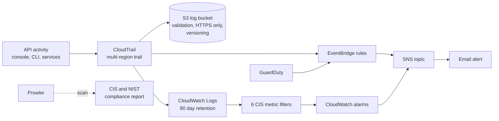

## Tools and why each one is here

| Tool | What it does in this project | Main controls |
|---|---|---|
| **IAM** | MFA, group-based permissions, password policy | AC-2, IA-2(1), IA-5 |
| **AWS Budgets** | Zero-spend alert set before any service was turned on | Cost guardrail |
| **CloudTrail** | Records every API call: who, what, when, from where | AU-2, AU-3, AU-12 |
| **S3** | Long-term log archive, locked down | AU-9, SC-8 |
| **CloudWatch Logs** | Live log feed for searching and alerting | AU-6, AU-11 |
| **Logs Insights** | Query language used for investigations, similar to a SIEM search | AU-6 |
| **GuardDuty** | Managed threat detection over CloudTrail, DNS and network logs | SI-4, RA-5 |
| **EventBridge** | Reacts to single events in real time | SI-4(5), AU-5 |
| **CloudWatch alarms** | Count matching log events over 5 minutes | SI-4, AC-7 |
| **SNS** | Sends every alert to one email | IR-6 |
| **CloudFormation** | Defines the whole detection layer as code | CM-2, CM-3 |
| **Prowler** | Open-source scanner mapping results to CIS and NIST | CA-2, RA-5 |
| **IAM Access Analyzer** | Flags any resource shared outside the account | AC-6 |

## Repo layout

```
.
├── README.md
├── cloudformation/
│   └── detection-alerting.yaml      # SNS, EventBridge rules, CIS metric filters and alarms
├── grc/
│   ├── control-matrix.md            # 28 NIST 800-53 controls mapped to CIS, with evidence
│   ├── risk-register.md             # 14 scored risks with treatment decisions
│   ├── poam.md                      # open weaknesses with milestones
│   └── ir-playbook-guardduty.md     # response playbook for High and Critical findings
└── screenshots/
```

---

## Phase 0: Account hardening and cost guardrails

Before building anything, I checked the identity basics and made sure nothing could quietly start costing money.

- **Root and IAM user both have MFA** (CIS 1.5, 1.10). Root is only used for the rare tasks that need it.
- **Permissions come from a group** (`admin`), not policies attached to the user (CIS 1.15).
- **IAM billing access** turned on so even cost checks don't need root.
- **Zero-spend budget** alerts the moment spend passes $0.01.
- **Billing baseline:** 6 months of cost history reviewed. The only spend was $0.16 in June from earlier training work. Nothing active was billing.

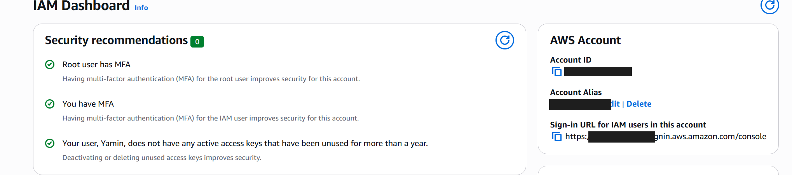
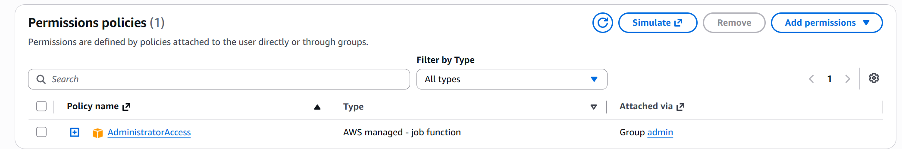
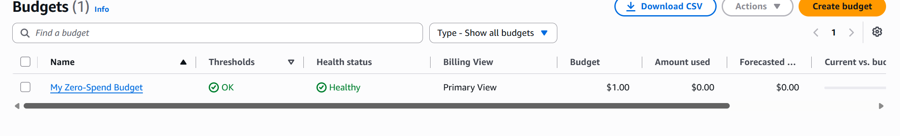
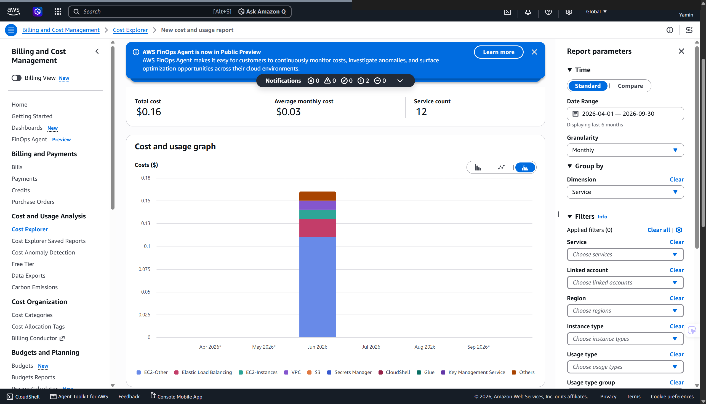

## Phase 1: CloudTrail logging

The account had no trail, only the 90 days of event history AWS keeps by default. That fails CIS 3.1, and it means anything older than 3 months is gone.

**What I set up:**

| Setting | Value | Why |
|---|---|---|
| Trail scope | Multi-region | An attacker can work in a region you never use |
| Events | Management, read and write | Covers every control-plane action (users, roles, logging, network) |
| Log file validation | On | Hourly digest files with hashes, so tampering with logs is detectable (CIS 3.2, AU-9) |
| Recursive logging | Off | Keeps CloudTrail from logging its own delivery calls into a loop |
| Encryption | SSE-S3 | KMS skipped to stay free, recorded as accepted risk R-04 |

The bucket policy CloudTrail created only lets **this specific trail** write to it, using an `aws:SourceArn` condition. That blocks the confused deputy problem, where another account's trail could use the CloudTrail service to write into my bucket.

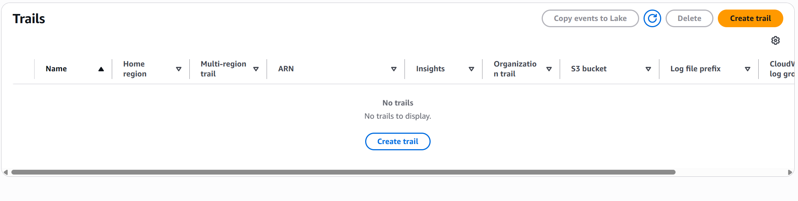
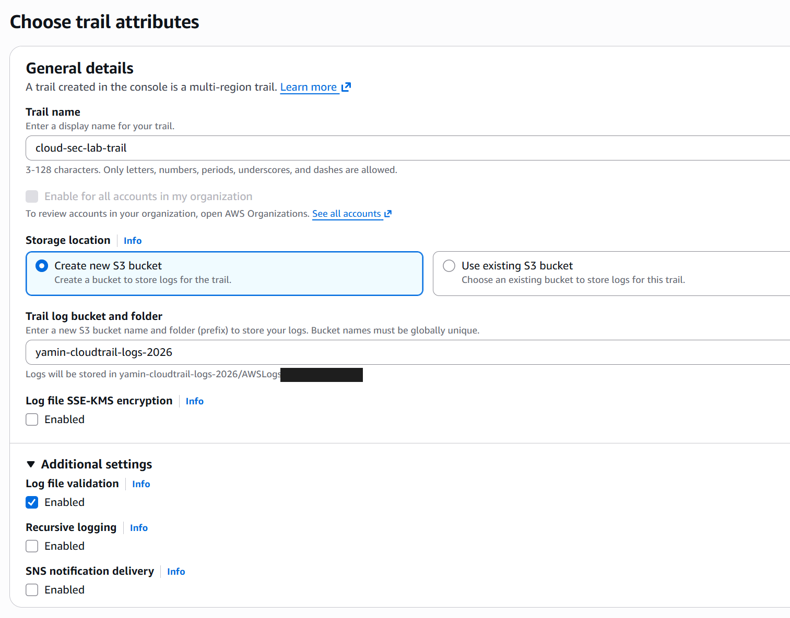
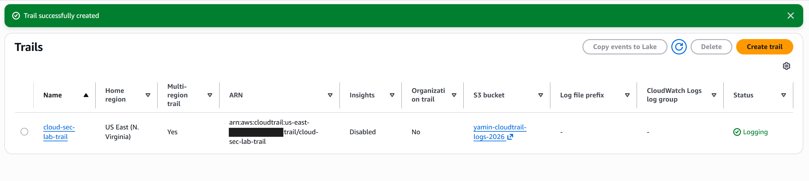
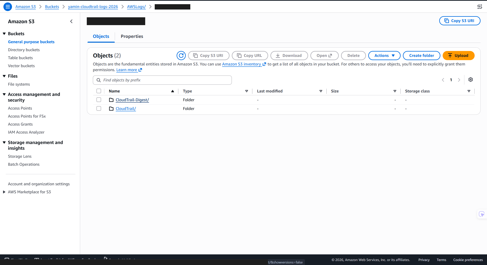
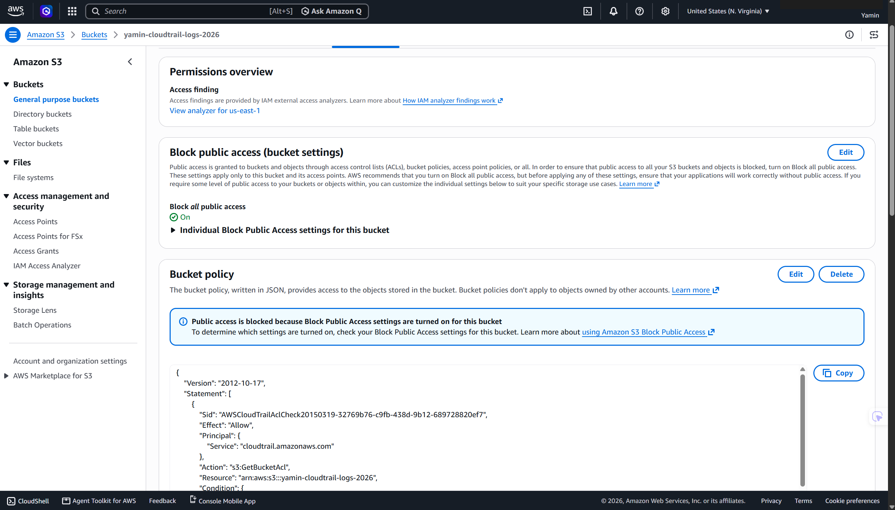

**First log review.** I pulled my own `CreateTrail` event and read it field by field. A few things worth knowing:

- Keys starting with `ASIA` are temporary console session credentials. Keys starting with `AKIA` are long-term keys, and an `AKIA` key used from an unfamiliar IP is how leaked keys usually get caught.
- `requestParameters` proves exactly what settings I chose, which is evidence on its own.
- The call came over TLS 1.3 (SC-8).

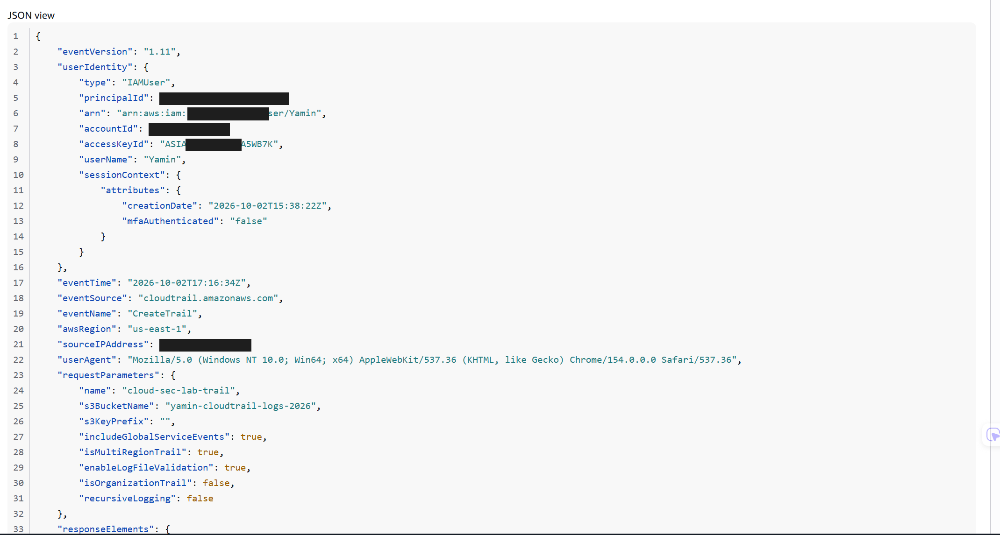

## Phase 2: GuardDuty threat detection

CloudTrail records what happened. GuardDuty decides whether it looks malicious.

I enabled GuardDuty, caught that I had first enabled it in the wrong region (Ohio) while signed in as root, disabled that one, and redid it in us-east-1 as the IAM user so all the evidence lines up. Then I generated sample findings to have something real to triage.

| Severity | Findings |
|---|---|
| Critical | 21 |
| High | 176 |
| Medium | 180 |
| Low | 68 |
| **Total** | **445** |

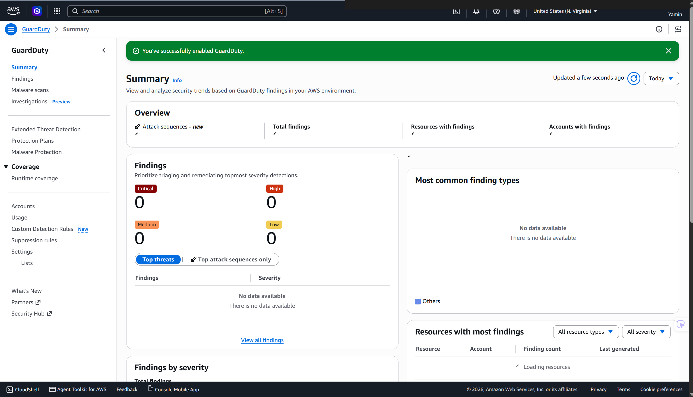
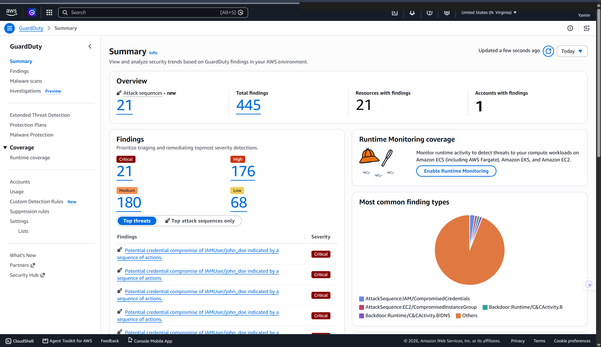

### Triage: AttackSequence:IAM/CompromisedCredentials (Critical)

GuardDuty linked 5 separate signals from one stolen session key into a single incident.

| # | Signal | MITRE tactic | Technique |
|---|---|---|---|
| 1 | `CreateRole` from a Tor exit node | Privilege Escalation, Persistence | T1098.003 |
| 2 | `DeleteTrail` from a Kali Linux host | Defense Evasion | T1562.008 |
| 3 | `AttachRolePolicy` from a Kali Linux host | Persistence | T1098 |
| 4 | CloudTrail trail disabled | Defense Evasion | T1562.008 |
| 5 | Anomalous Bedrock model invocation | Impact | T1496 |

The attacker built a backdoor role that would survive the key being revoked, attacked logging twice, then ran up charges on the account's AI service. Two of the five signals target logging, which is exactly why Phase 3 includes a tampering alert.

I also confirmed it was sample data before writing it up: the "Tor exit node" was `10.0.0.1` (a private address), all five signals had the same timestamp, and the Bedrock ARN used AWS's placeholder account `123456789012`. The full response steps are in the [IR playbook](grc/ir-playbook-guardduty.md).

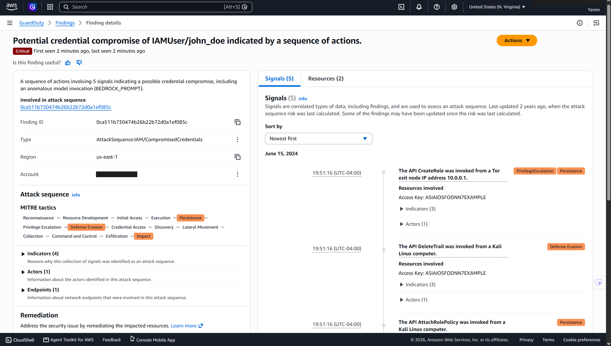
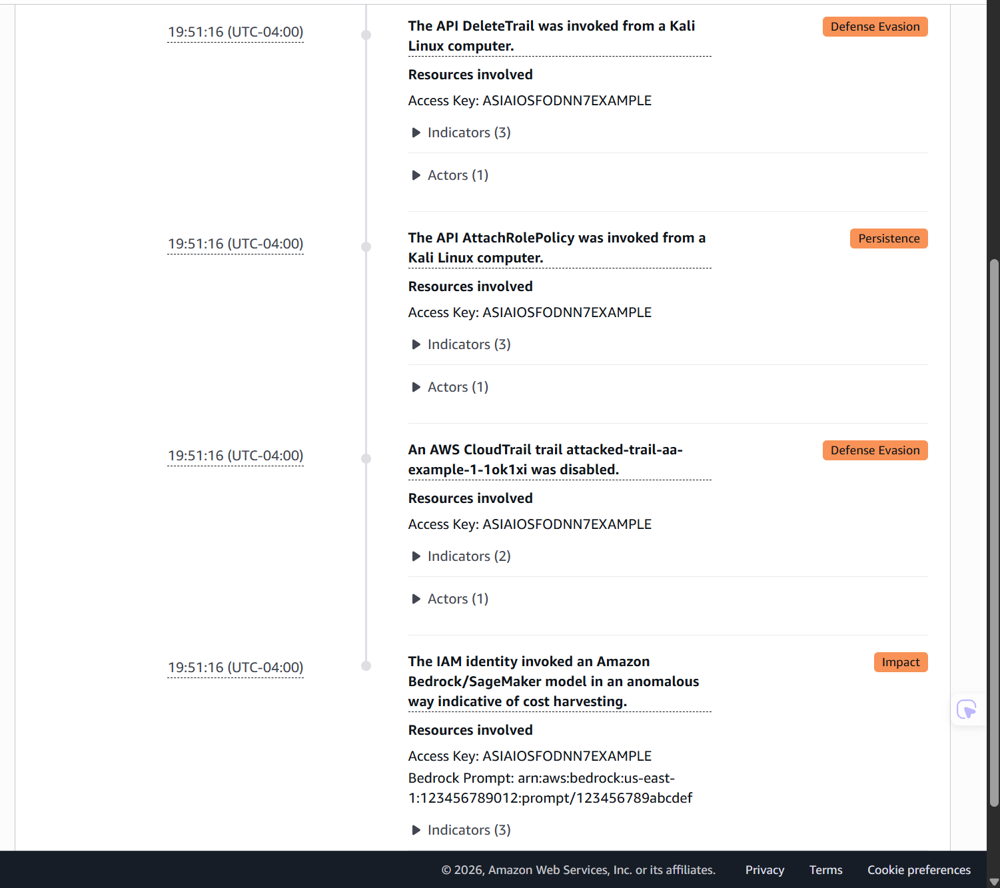

## Phase 3: Alerting as code

First I connected CloudTrail to CloudWatch Logs (CIS 3.4) with a role that can only write to one log stream, and set retention to 90 days. S3 stays the archive, CloudWatch is the live feed.

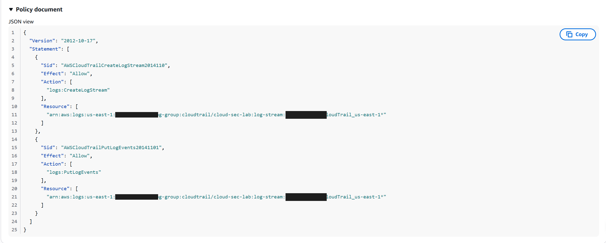
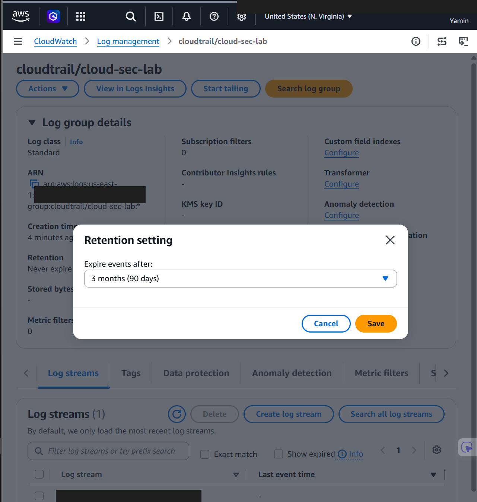
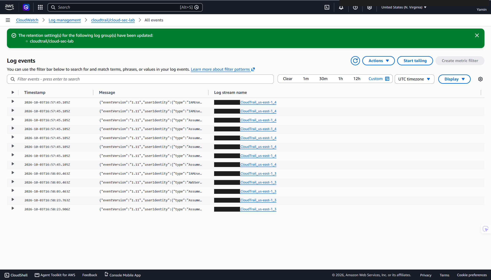

Then I wrote the whole detection layer as a [CloudFormation template](cloudformation/detection-alerting.yaml), validated it, and deployed it from CloudShell. **17 resources, all `CREATE_COMPLETE`.**

| Detection | Type | Fires on | Mapping |
|---|---|---|---|
| GuardDuty High and Critical | EventBridge | Any finding with severity 7.0 or higher | SI-4(5), IR-6 |
| Security tooling tampering | EventBridge | `StopLogging`, `DeleteTrail`, `UpdateTrail`, `PutEventSelectors`, `DeleteDetector`, `UpdateDetector` | CIS 4.5, AU-5 |
| Unauthorized API calls | Metric alarm | 5 or more denied calls in 5 min | CIS 4.1 |
| Console login without MFA | Metric alarm | Any successful IAM user login without MFA | CIS 4.2 |
| Root account usage | Metric alarm | Any root action | CIS 4.3 |
| IAM policy changes | Metric alarm | Any policy create, change, attach or detach | CIS 4.4 |
| Console login failures | Metric alarm | 3 or more failures in 5 min | CIS 4.6 |
| Security group changes | Metric alarm | Any rule or group change | CIS 4.10 |

Two design choices worth calling out:

- **EventBridge vs. metric filters.** Someone stopping CloudTrail needs an alert right now, so that goes through EventBridge. Patterns like repeated denied calls make more sense as a count over a window.
- **Tuned thresholds.** One denied API call is usually a misclick, so that alarm waits for 5. Three failed logins in 5 minutes looks like guessing.

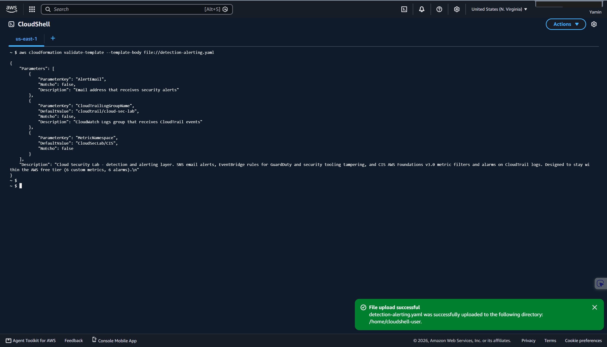
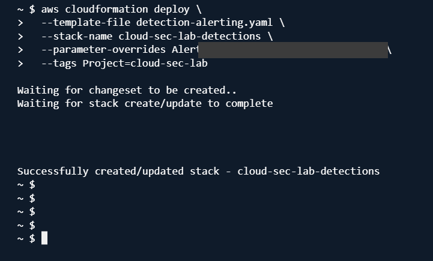
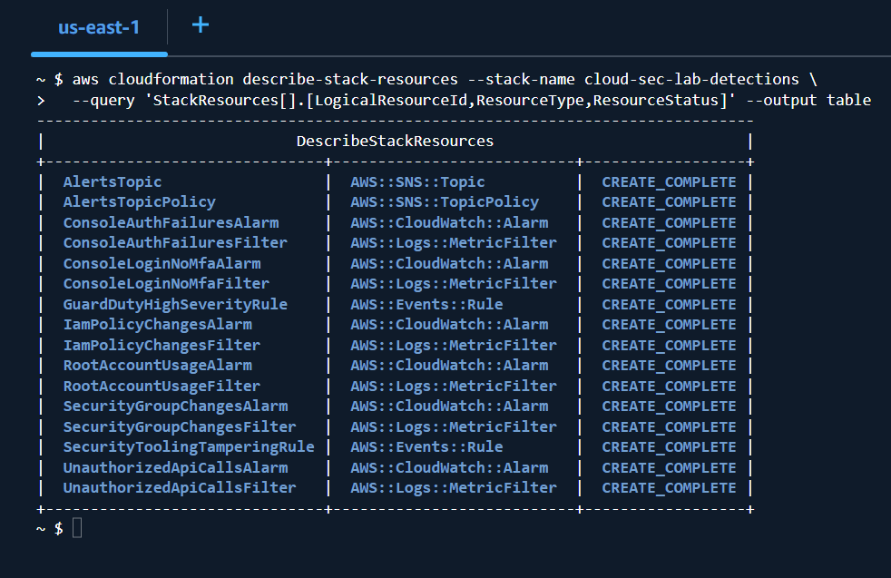

### Testing every path

A detection that has never fired is an assumption. I triggered each one with a harmless version of the real behavior.

| Test | Path | How I triggered it | Time to email |
|---|---|---|---|
| Trail tampering | EventBridge | `update-trail` with no real change | Under 1 min |
| GuardDuty tampering | EventBridge | Changed the finding publish frequency | Under 1 min |
| GuardDuty High finding | EventBridge | One severity 8 sample finding | About 1 min |
| Root usage | Metric alarm | Not planned, see below | About 5 min |
| Failed logins | Metric alarm | 3 wrong passwords in 29 seconds | 3 min 47 s |

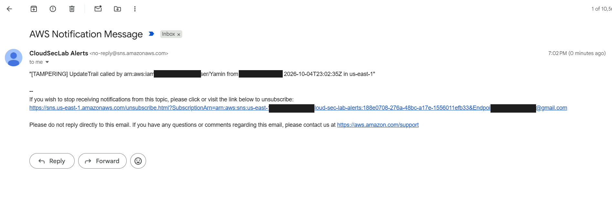
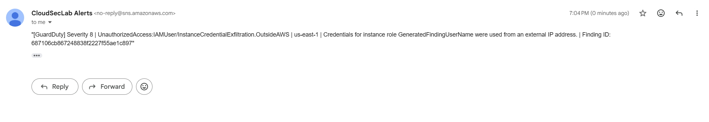
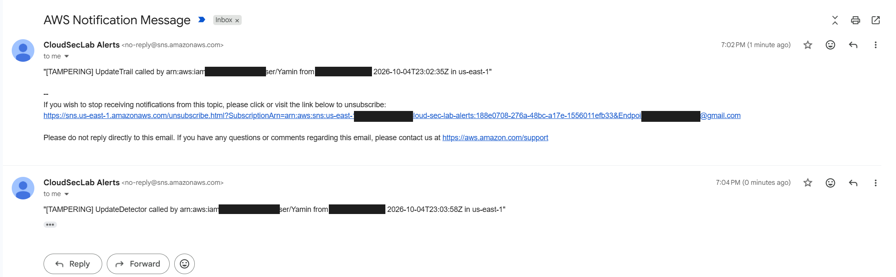
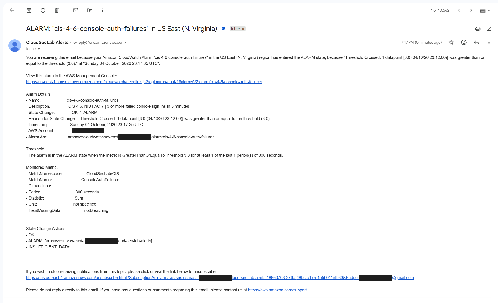
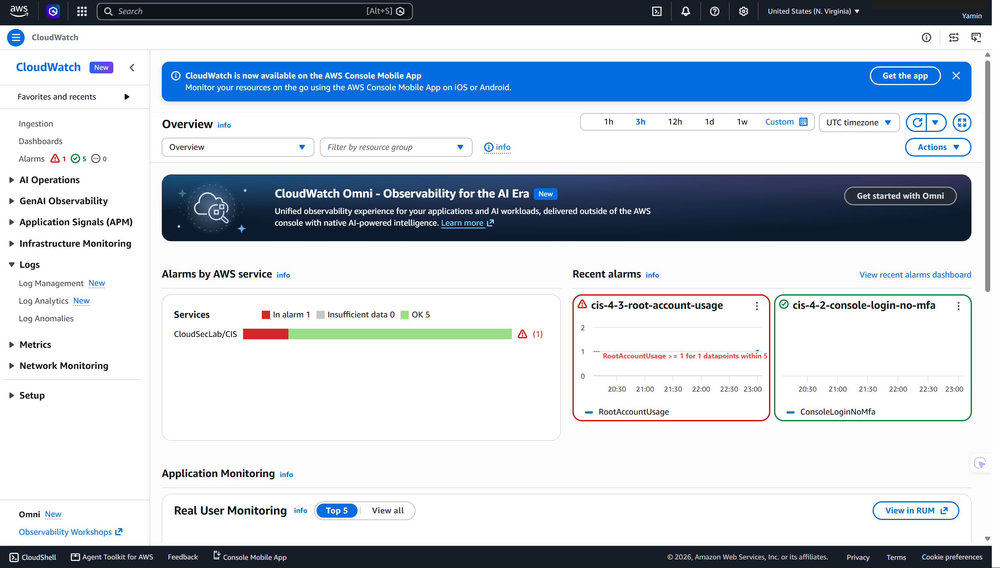

### Investigation 1: the root alarm I didn't trigger on purpose

The root usage alarm fired while I was testing something else. Instead of assuming it was me, I queried the logs.

```
fields @timestamp, eventName, userIdentity.type, responseElements.ConsoleLogin, additionalEventData.MFAUsed, sourceIPAddress
| filter userIdentity.type = "Root" or eventName = "ConsoleLogin"
| sort @timestamp desc
```

**What it showed:** I had signed in as root and as my IAM user at the same moment (multi-session), and the root tab was still open. The console's notification bell kept calling `ListManagedNotificationEvents` as root every few minutes for at least 38 minutes. Same IP as my IAM login, MFA used on both.

**Verdict:** real root activity, benign cause. I closed the session and logged the root cause as risk R-06 (NIST AC-12, session termination). The detection did its job by catching something I had forgotten about.

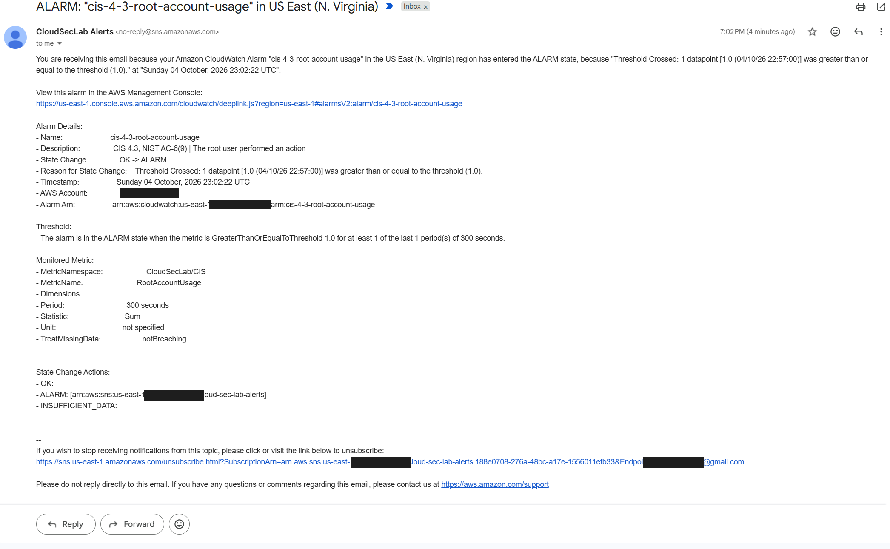
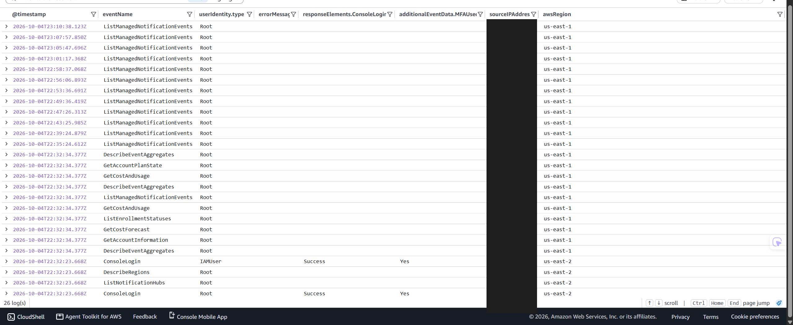

### Investigation 2: why the first failed login test didn't fire

My first 3 "wrong password" attempts never showed up as failures. The passkey prompt kept appearing, which only happens **after** the password is accepted, so the browser had been filling in my real password. On the retry I typed a wrong one manually and got 3 clean `Failed authentication` events.

One more thing I noticed in those events: `MFAUsed` says `Yes` even on failed attempts that never reached the MFA step. On a failure, that field means the user has MFA set up, not that MFA was completed.

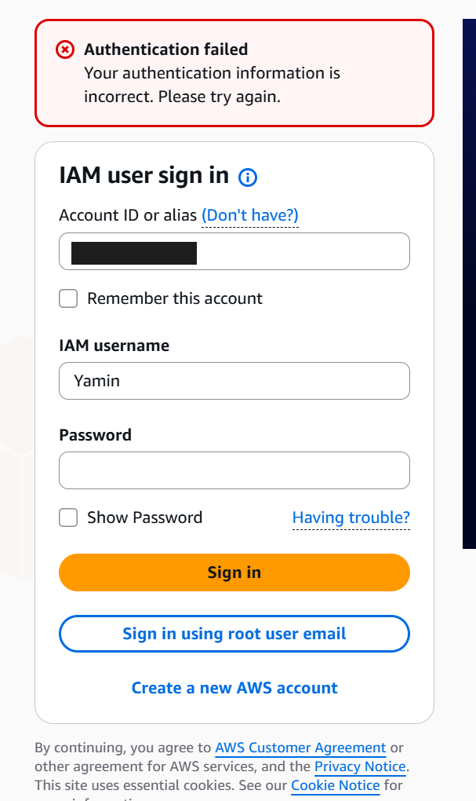
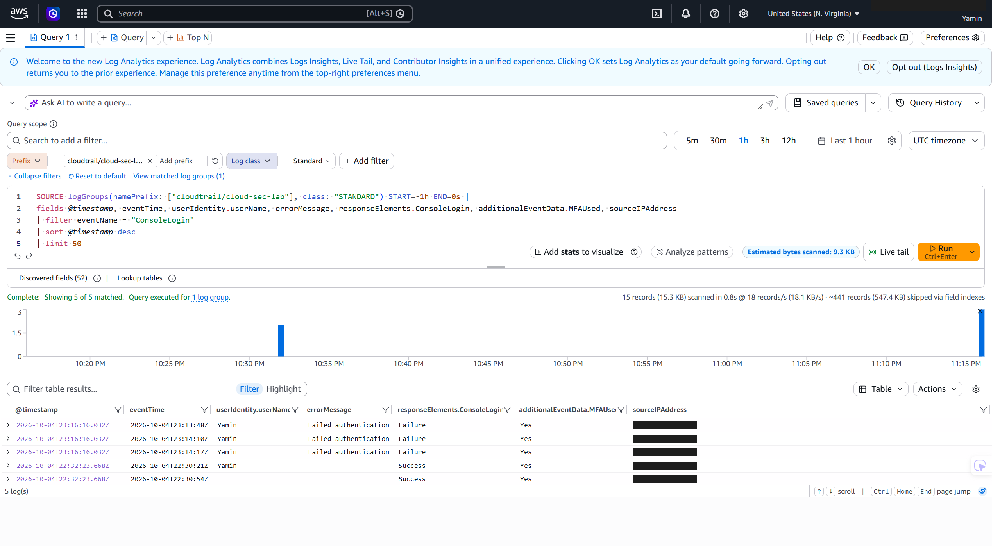

## Phase 4: Compliance scan with Prowler

AWS Config and Security Hub charge by usage, so I used Prowler instead. It's free, open source, and maps every check to CIS and NIST. The scan was scoped to us-east-1 plus global services like IAM, which matches the project.

**Baseline (before any fixes):**

| Metric | Result |
|---|---|
| Checks | 249 (131 pass, 112 fail, 6 manual) |
| CIS AWS 4.0 | 48.6% passing, 16 of 47 requirements fully met |
| NIST 800-53 Rev. 5 | 59.8% passing |
| Failures | 2 Critical, 16 High, 60 Medium, 34 Low |

**The headline finding:** a bucket left over from earlier training, `yamin-demo-s3-v1`, was **public**. Its policy allowed `Principal: *` to download any object, and Block Public Access was off at both the bucket and account level.

One result I disagree with: Prowler marks CIS 4.5 (alert on CloudTrail changes) as failed, because it only looks for a metric filter. That alert exists and was tested, it just runs on EventBridge. I documented it as a **compensating control** in the matrix.

## Phase 5: Remediation

I worked the findings in order of risk and verified each fix directly, not just through the scanner.

| Finding | Severity | Fix | Proof |
|---|---|---|---|
| Public S3 bucket | Critical | Account-level Block Public Access, then deleted the public policy | Anonymous `curl` returns **403** |
| Block Public Access off | High (x2) | Same account-level setting | Prowler PASS |
| Stale access key, 130 days | Medium (x2) | Deactivated, then deleted | `list-access-keys` returns `[]` |
| No password policy | Medium (x6) | 14 chars, all character types, 24 password history | Prowler PASS |
| Access Analyzer off | Low | Created an account analyzer | Prowler PASS |
| Log bucket allows HTTP | Medium | Added a `DenyInsecureTransport` statement with `jq`, after backing up the old policy | Prowler PASS |
| Log bucket versioning off | Medium | Enabled | Prowler PASS |
| GuardDuty test findings | High | Archived all 445 in batches of 50 | 0 active findings |

**What the public bucket held:** 3 demo files (about 199 KB, no sensitive data), exposed for roughly 120 days. The harder lesson is that **I can't prove whether anyone downloaded them**, because S3 data events and access logging were off. With customer data in that bucket, nobody could say what was taken. That gap is risk R-05.

After the bucket policy change I confirmed CloudTrail was still delivering (`Logging: true`, no delivery error). Check before, change, verify after.

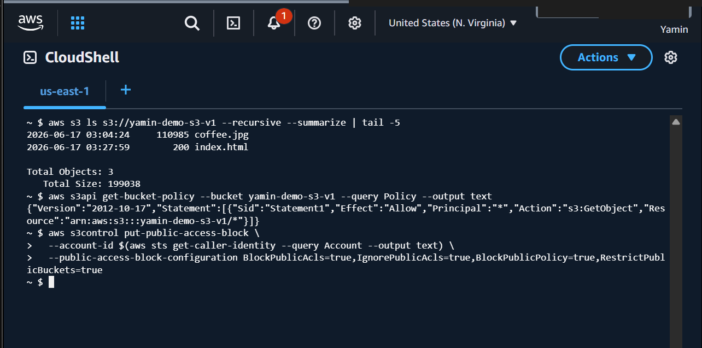
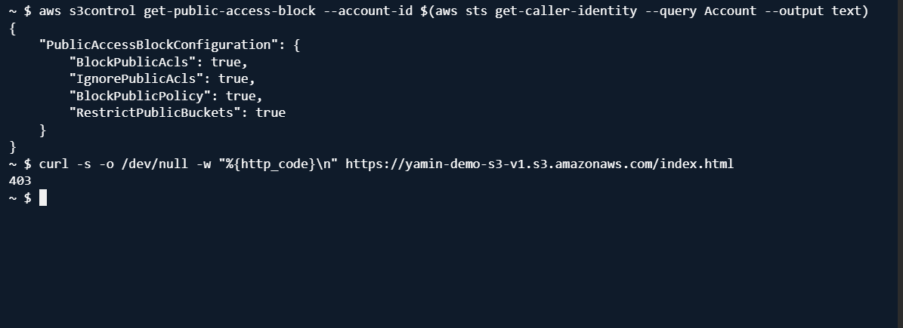
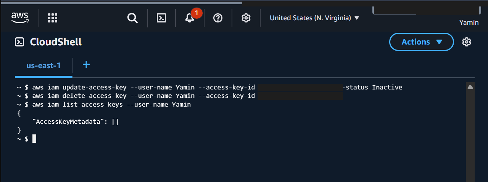
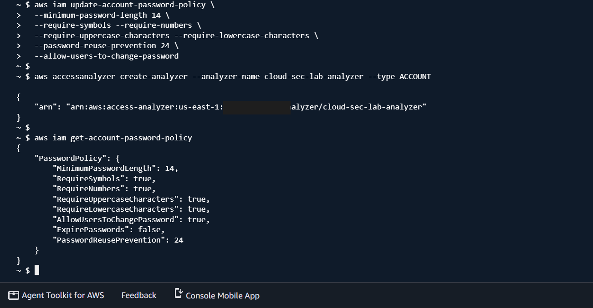
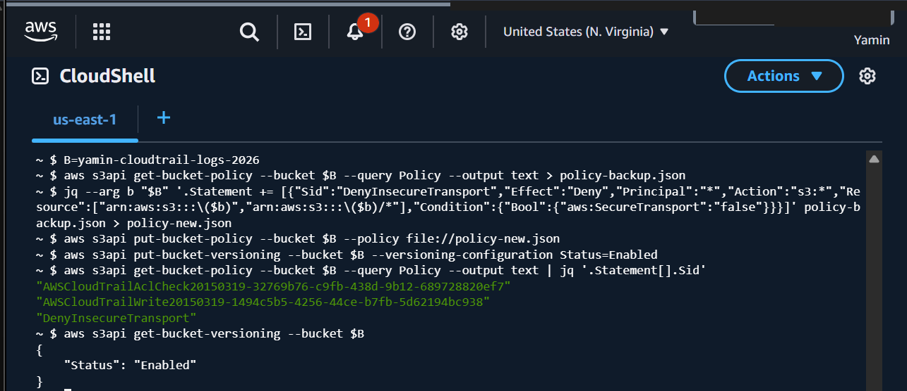
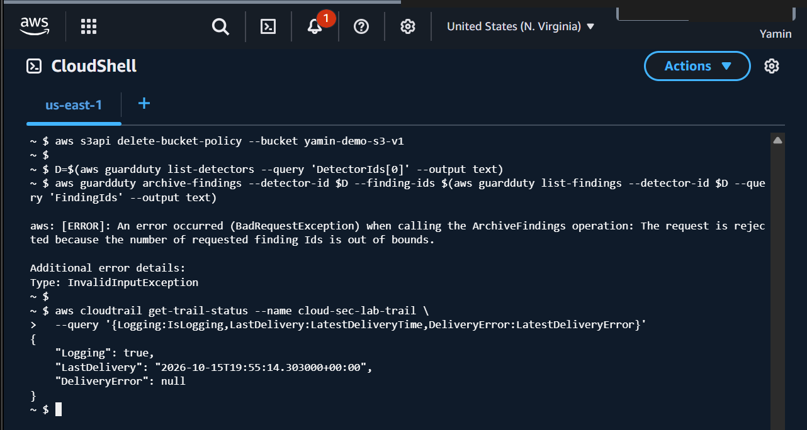
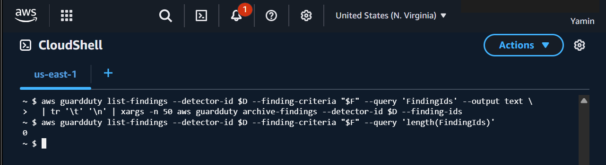

### Before and after

| Metric | Before | After | Change |
|---|---|---|---|
| **CIS AWS 4.0** | 48.6% | **57.5%** | +8.9 pts |
| CIS requirements fully met | 16 / 47 | **20 / 47** | +4 |
| **NIST 800-53 Rev. 5** | 59.8% | **66.4%** | +6.6 pts |
| NIST requirements fully met | 62 / 244 | **103 / 244** | +41 |
| AWS Foundational Best Practices | 50.4% | **62.7%** | +12.3 pts |
| Total failures | 112 | **98** | -14 |
| Critical / High | 2 / 16 | **1 / 13** | |
| New failures introduced | | **0** | |

**Evidence currency note:** Prowler still flagged the deleted access key after the rescan. It reads the IAM credential report, which AWS only regenerates every 4 hours. The direct API check was the stronger evidence, and the item stays open in the POA&M until the scanner catches up.

## Phase 6: GRC documentation

| Document | Contents |
|---|---|
| [Control matrix](grc/control-matrix.md) | 28 NIST 800-53 controls mapped to CIS 4.0 with evidence. 19 implemented, 7 partial, 1 compensating, 1 accepted. |
| [Risk register](grc/risk-register.md) | 14 risks scored by likelihood and impact. Both High risks closed, 7 accepted with written reasons. |
| [POA&M](grc/poam.md) | Open weaknesses with milestones, plus two "will not fix" decisions and why |
| [IR playbook](grc/ir-playbook-guardduty.md) | NIST 800-61 response steps for GuardDuty High and Critical findings, with containment commands and a worked example |

Two decisions in there that go against the scanner, on purpose:

- **No password expiration.** NIST SP 800-63B advises against forced periodic changes because people respond with `Password1!`, `Password2!` and so on.
- **No MFA Delete on the log bucket.** It can only be enabled with root access keys, and creating those would cause a worse finding (CIS 1.4) than the one it fixes.

## Phase 7: Teardown and cost

- Turned on **termination protection** for the detection stack.
- **Deleted the GuardDuty detector** before the free trial ended, so it can't bill.
- Left the free pieces running (trail, alarms, Access Analyzer, budget) so the project is still live.

**Final cost: $0.03**, all from S3 in us-east-1. The likely source is request charges: a multi-region trail writes log files from every region, and those `PUT` requests add up past the free tier.

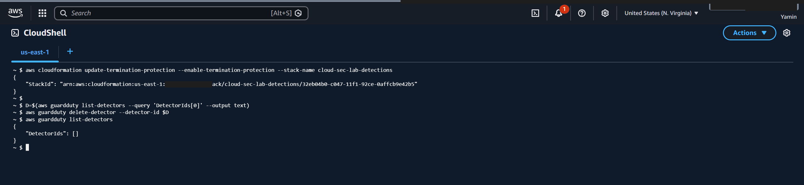
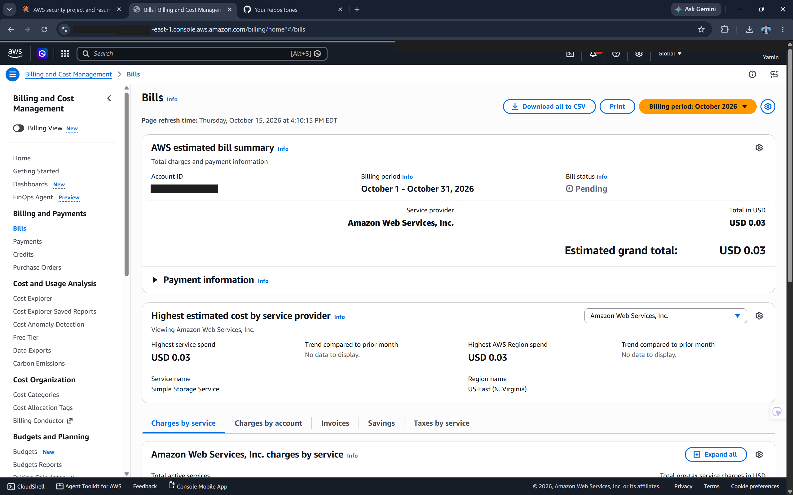

---

## What I took away from this

1. **Leftover resources are the real risk.** The worst finding wasn't in anything I built. It was a training bucket from months ago that nobody was watching.
2. **Test your detections.** Two of my five tests taught me something (an open root session, a browser autofilling a password) that I would have missed if I'd only deployed the rules.
3. **Logging gaps matter most when you need the logs.** I could close the public bucket in one command, but I still can't say who read it.
4. **Scanners are evidence, not the truth.** Prowler missed a control that existed (EventBridge for CIS 4.5) and reported a key that was already deleted. Knowing why is part of the job.
5. **"Accepted risk" needs a reason in writing.** Every gap I left open has a cost, a compensating control, or published guidance behind it.

## Deploy the detection stack yourself

Requires a CloudTrail trail sending to a CloudWatch Logs group.

```bash
aws cloudformation validate-template --template-body file://cloudformation/detection-alerting.yaml

aws cloudformation deploy \
  --template-file cloudformation/detection-alerting.yaml \
  --stack-name cloud-sec-lab-detections \
  --parameter-overrides AlertEmail=you@example.com CloudTrailLogGroupName=your/log-group \
  --tags Project=cloud-sec-lab
```

Confirm the SNS subscription email, then test with a harmless `aws cloudtrail update-trail --name YOUR_TRAIL --enable-log-file-validation`.

## Skills demonstrated

**Cloud security:** AWS IAM, CloudTrail, GuardDuty, CloudWatch Logs and alarms, EventBridge, SNS, S3 security, IAM Access Analyzer, CloudShell, AWS CLI
**Detection and response:** alert design and tuning, detection testing, log analysis with Logs Insights, finding triage, MITRE ATT&CK mapping, incident response playbooks
**GRC:** NIST SP 800-53 Rev. 5, CIS AWS Foundations v4.0, NIST SP 800-61, NIST SP 800-63B, control mapping, risk scoring, POA&M tracking, compensating controls, evidence collection
**Tooling:** CloudFormation (IaC), Prowler, bash, jq

---

*Account IDs, IP addresses, key IDs and email addresses are redacted in all screenshots.*
